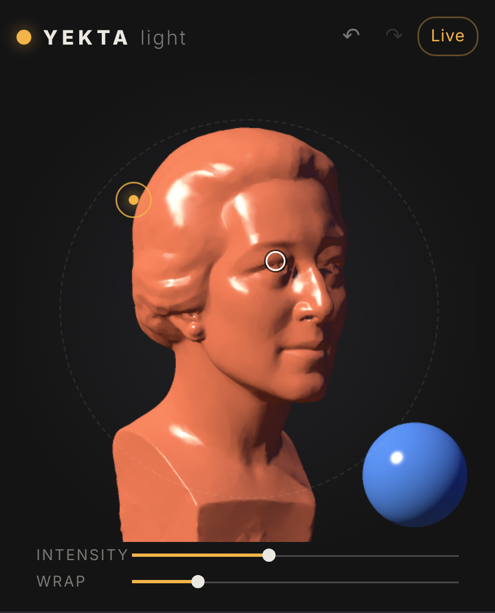

# Yekta Light

**The 3D light color picker for painters.** Free for Photoshop and Clip Studio Paint.

Light a real 3D form — scanned heads, a skull, posable full bodies, study forms — and pick the exact color the light creates:
highlight, halftone, terminator, core shadow, reflected light, cast shadow.



## Download

| | |
|---|---|
| **Photoshop** (Win & Mac, PS 2022 / 23.3+) | [YektaLight.ccx](https://github.com/yektapour/yekta-site/releases/download/yekta-light-v2.0.0/YektaLight.ccx) |
| **Clip Studio Paint — Windows** | [YektaLight-Windows.zip](https://github.com/yektapour/yekta-site/releases/download/yekta-light-v2.0.0/YektaLight-Windows.zip) |
| **Clip Studio Paint — Mac (Apple Silicon)** | [YektaLight-macOS-AppleSilicon.zip](https://github.com/yektapour/yekta-site/releases/download/yekta-light-v2.0.0/YektaLight-macOS-AppleSilicon.zip) |
| **Clip Studio Paint — Mac (Intel)** | [YektaLight-macOS-Intel.zip](https://github.com/yektapour/yekta-site/releases/download/yekta-light-v2.0.0/YektaLight-macOS-Intel.zip) |

Guides: [Photoshop](docs/YektaLight-Install-Photoshop.pdf) · [Clip Studio Windows](docs/YektaLight-Install-ClipStudio-Windows.pdf) · [Clip Studio macOS](docs/YektaLight-Install-ClipStudio-macOS.pdf) · [User guide](docs/YektaLight-User-Guide.pdf)

Video: [2-minute walkthrough](media/YektaLight-walkthrough-16x9.mp4) · [60-second vertical](media/YektaLight-walkthrough-9x16.mp4)

## Repository layout

```
plugin/core        shared panel (HTML/JS, no dependencies): renderer, UI, host adapters, 3D meshes
plugin/photoshop   UXP manifest
plugin/desktop     Electron shell for the Clip Studio window
plugin/tools       build script  →  node plugin/tools/build.js
docs/              install guides + user guide (PDF)
media/             videos, posters, screenshots, icon
WEBSITE-BRIEF.md   everything needed to build the product page on yektapour.com
```

## Credits

- Male head: “Lee Perry-Smith” head scan © Infinite-Realities — CC BY 3.0.
- Female head: “Woman’s Head” by Artur Loewental, scan from Three D Scans (Oliver Laric) — no copyright restrictions.
- Skull: Vladimir Petkovic, Khronos glTF Sample Assets — CC0.
- Full bodies: Grab3D Man / Woman Base Mesh — CC0 (finger rig added by Yekta Light).
- Mannequins: Quaternius Universal Base Characters — CC0.

Made by [yektapour.com](https://yektapour.com).
